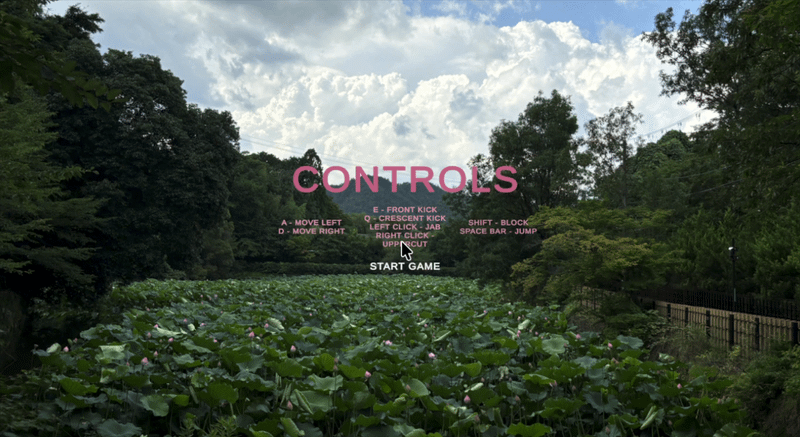

# 2D-Fighter-Game
2D retro-style fighter game using Unity. Initially designed for CS A-Level NEA component, received an A* on the NEA.

# Description
'Duelbound' is a 2D fighter game, taking inspiration from retro, arcade-style games. Originally designed for the NEA component of Computer Science A-level, it is currently being worked on to develop its systems further.

The game is designed for a range of players, aiming to appeal to modern audiences with the graphics, retro gamers with its mechanics, novice gamers with the simple best-of-three round system and experienced gamers with its combat variety.

The purpose of this project was to effectively implement object-oriented paradigms in a personal project, combining my interest in video game and AI development. Designing the finite state machine AI opponent's behaviour, allowed me to apply the knowledge from the rest of the Computer Science A-level curriculum, and research further into complex algorithms and forms of AI. The book 'Multiagent Systems: Algorithmic, Game-Theoretic, and Logical Foundations' (Shoham, Leyton-Brown) helped build a stronger contextual understanding of what I was designing.

# Features
- 4 attack types, broken down into: Jab, Uppercut, Front Kick, Crescent Kick
- Blocking mechanism
- Health and stagger bars
- AI opponent, modelling a finite state machine

# Controls
- A : Left
- D : Right
- Space : Jump
- Shift : Block

-  E : Jab
-  Q : Uppercut
-  Left-click : Front Kick
-  Right-click : Crescent Kick

## Getting Started

### Dependencies
Unity 6.6 (install it through Unity Hub).

### Installing
1. Clone the repository: `git clone https://github.com/mdelgernaran/2D-Fighter-Game`
2. Open Unity Hub, click **Add → Add project from disk**, and select the cloned folder.
3. Open the project and wait for Unity to import the assets.
4. Open `Assets/Scenes/start screen` and press Play.

## Authors

Michelle Delgernaran

[LinkedIn](https://www.linkedin.com/in/michelledelgernaran/)

## Version History

* 0.1
    * Initial Release
